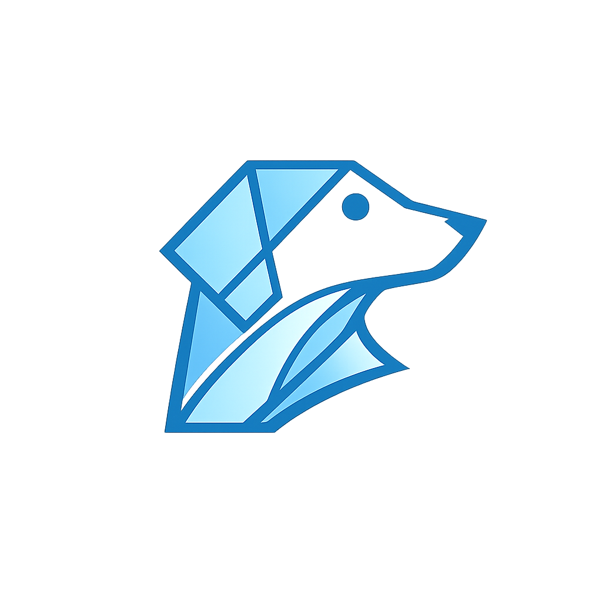

# Doggo

<p align="center">
  
</p>

Doggo は、Go パッケージを Lisp の式から呼び出せる、バイトコード VM 上で動作する汎用の動的プログラミング言語です。Go のライブラリを活用しながら、小さなスクリプトからアプリケーションまで記述できます。

## Go パッケージを Doggo から呼び出す

プロジェクトを作り、そのルートに `hello.dog` を作成します。`strings` は既定で登録されている Go 標準パッケージです。

```bash
doggo new app hello
cd hello
```

```doggo
(import "strings")

(println (strings/ToUpper "doggo"))
```

```bash
doggo build
doggo exec -- hello.dog
```

```text
"DOGGO"
```

`import` は登録済みの Go パッケージを読み込みます。公開関数は `パッケージ名/関数名` の形で呼び出します。

## Go との相互運用

Doggo と Go は、関数とインターフェースを通じて双方向に連携できます。

- Go の公開関数とコンストラクターを Doggo から呼び出す
- Go の値にある公開メソッドと公開フィールドへアクセスする
- Doggo の関数を `reify` で Go のインターフェース実装として渡す
- プロジェクトが利用する Go モジュールを検出し、型変換と呼び出しに必要なコードを生成する

詳しい追加手順と対応範囲は [Go 連携](docs/go-interop.md) で確認できます。

## 言語と標準ライブラリ

Doggo は Lisp の S 式を採用し、関数呼び出しをリストで記述します。マクロでコードを組み立てたり変換したりでき、標準ライブラリからファイル、HTTP、並行処理などを利用できます。

- リスト、ベクター、マップ、セットによる不変データ
- 遅延シーケンスと高階関数
- マクロ、プロトコル、レコード、マルチメソッド
- 構造化された例外
- Atom、Ref、Agent、Channel による状態管理と並行処理
- EDN、JSON、CSV、XML、HTTP、ファイル、プロセス、テストを扱う標準ライブラリ

## Go 連携をプロジェクトへ組み込む

`doggo new` は新しいプロジェクトと初期 sync-only generation を作ります。既存プロジェクトでは、`doggo mod sync` が依存関係を解決し、Go の公開 API とインターフェースを検出して、実行ファイルを含まない immutable な sync-only generation を `doggo.lock` に記録します。`doggo deps update` も、選択した依存または全依存を再解決して sync-only generation を公開します。`doggo build` はそこから実行ファイルを含む新しい built generation を作り、`doggo exec --` は検証済みの現在世代を実行します。

ローカルの Go モジュールを追加する場合は、次の順に実行します。

```bash
doggo deps add ../greeter
doggo mod sync
doggo build
doggo exec -- app.dog
```

## 開発ツール

Doggo は、プロジェクト作成からエディター連携までを `doggo` CLI のサブコマンドから扱います。

| コマンド | 用途 |
| --- | --- |
| `doggo new app my-app` | アプリケーション用のプロジェクトを作成する |
| `doggo new lib my-lib` | ライブラリ用のプロジェクトを作成する |
| `doggo new cli my-tool` | コマンドライン用のプロジェクトを作成する |
| `doggo fmt --check .` | ソースコードの書式を確認する |
| `doggo lint .` | 構文、`require`、`import` の規則を静的に検査する |
| `doggo test` | `*_test.dog` を検出して実行する |
| `doggo build` | 現在の lock から実行ファイルを含む built generation を確定する |
| `doggo exec -- app.dog` | ビルド済みのプロジェクト世代でプログラムを実行する |
| `doggo deps list` | 登録済みの依存元を確認する |
| `doggo deps update --all` | 全依存を再解決した sync-only generation を確定する |
| `doggo mod sync` | 依存関係、連携コード、lockを同期する |
| `doggo exec -- lsp` | ビルド済みのプロジェクト世代で Language Server を起動する |

## 処理系

Doggo はソースコードを構文木へ変換し、コンパイラがバイトコードを生成します。スタックを使う VM が、そのバイトコードを実行します。

コンパイラ、バイトコード、オペランドスタック、VM の仕組みは [Doggo のコードが動くまで](docs/how-doggo-works.md) で説明しています。

## インストール

Doggo は Go 1.26.10 でのソースビルドを検証しています。以下を Doggo のソースディレクトリで実行します。

```bash
go version
go mod download
go install ./cmd/doggo
export PATH="$(go env GOPATH)/bin:$PATH"
doggo version
```

`doggo version` に続けてバージョン番号が表示されれば利用できます。

## ドキュメント

| 文書 | 内容 |
| --- | --- |
| [15 分ではじめる Doggo](docs/getting-started.md) | タスク管理用のコマンドラインアプリケーションを作る |
| [言語ガイド](docs/language-guide.md) | 言語の基本概念を順に学ぶ |
| [標準ライブラリ](docs/standard-library.md) | 目的と名前空間から公開 API を調べる |
| [開発ツール](docs/tooling.md) | 整形、検査、テスト、ビルド、LSP を使う |
| [Go 連携](docs/go-interop.md) | Go パッケージ、メソッド、インターフェースを利用する |
| [Ebitengine で画面を表示する](docs/ebitengine-tutorial.md) | Go のゲームライブラリでウィンドウを表示する |
| [Doggo のコードが動くまで](docs/how-doggo-works.md) | コンパイラと VM の構造を理解する |

## ライセンス

[MIT License](LICENSE)
