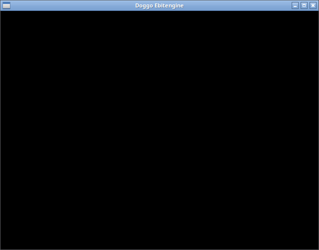

# Ebitengine で画面を表示する

このチュートリアルでは、Doggo のプロジェクトへ Ebitengine を追加し、ウィンドウを表示します。Doggo の式と関数をまだ実行したことがない場合は、先に [15 分ではじめる Doggo](getting-started.md) を進めてください。

## 1. 必要な環境を確認する

Doggo をソースからビルドでき、`doggo` コマンドを実行できる環境を用意します。Doggo のビルドには Go 1.26.10 が必要です。Ebitengine の取得には Go ツールチェーンとネットワーク接続を使います。

```bash
go version
doggo version
```

ウィンドウの表示には、OS ごとのグラフィックス用ライブラリと、ウィンドウを開けるグラフィカルなデスクトップ環境も必要です。[Ebitengine の公式インストール手順](https://ebitengine.org/ja/documents/install.html) に従って準備してください。

以下のコマンド例は、macOS、Linux などの POSIX シェルを前提とします。Windows での実行方法は第5章で説明します。

## 2. Doggo プロジェクトを作る

```bash
doggo new app hello-ebitengine
cd hello-ebitengine
```

`hello-ebitengine` がプロジェクトのディレクトリです。以降のコマンドは、このディレクトリを現在の作業ディレクトリとして実行します。

## 3. Ebitengine を追加して同期する

```bash
doggo deps add github.com/hajimehoshi/ebiten/v2@v2.9.9
doggo mod sync
```

最初のコマンドは Ebitengine を `doggo.mod` の依存関係へ追加します。`github.com/hajimehoshi/ebiten/v2` は Go モジュールパス、`v2.9.9` は解決するモジュールの正確なバージョンです。Doggo のソースでは、バージョンサフィックスを付けずに同じモジュールパスを `import` します。

`doggo.mod` はプロジェクトが使う依存関係を記録するファイルです。`doggo mod sync` は依存関係と Go 連携コードを immutable な sync-only generation に固定します。

同期に失敗した場合は、表示されたエラーに応じてネットワーク接続、Go のバージョン、Ebitengine の公式インストール手順にある OS ごとの準備を確認します。

## 4. 画面を表示する

[完成例](../examples/hello-ebitengine/README.md)と同じように、生成されたソースとテストを置き換えます。まず `src/hello_ebitengine/layout.dog` を作ります。

```doggo
(ns hello_ebitengine.layout)

(def layout
  (fn [_width _height]
    [320 240]))
```

このファイルは Ebitengine に依存しないため、グラフィカルな画面がない環境でも論理画面サイズの計算をテストできます。次に `src/hello_ebitengine/core.dog` を作ります。

```doggo
(ns hello_ebitengine.core
  (:require [doggo.cli :as cli]
    [hello_ebitengine.layout :as layout]))

(import "github.com/hajimehoshi/ebiten/v2")

(def game
  (reify v2/Game
    {:update (fn [] nil)
      :draw (fn [_screen] nil)
      :layout layout/layout}))

(def main
  (fn [& _args]
    (v2/SetWindowSize 640 480)
    (v2/SetWindowTitle "Doggo Ebitengine")
    (v2/RunGame game)))

(when (cli/entrypoint?)
  (cli/main main))
```

`SetWindowSize` はウィンドウの幅と高さを指定します。`SetWindowTitle` はタイトルバーに表示する文字列を指定します。

`reify` は、Doggo の関数をインポートした `v2/Game` インターフェースの実装として渡せるようにします。Ebitengine は、この三つの関数をゲームループから呼び出します。

- `update` は状態を更新します。この例では状態を変更しません。
- `draw` は画面を描画します。この例では何も描画しないため、ウィンドウの中は黒く表示されます。
- `layout` は Ebitengine が描画に使う画面の幅と高さを返します。

`RunGame` はゲームループを開始します。`doggo.cli` のエントリーポイント判定により、このファイルが CLI のエントリーポイントとして実行されたときだけゲームを開始します。

最後に、生成された `test/hello_ebitengine/core_test.dog` を次の内容で置き換えます。

```doggo
(ns hello_ebitengine.core-test
  (:require [doggo.test :as t]
    [hello_ebitengine.layout :as layout]))

(t/deftest layout-test
  (t/is (= [320 240] (layout/layout 640 480))))
```

このテストはレイアウトだけを読み込むため、Ebitengine や GUI を初期化せずに実行できます。

## 5. プログラムを実行する

POSIX シェルと Windows PowerShell のどちらでも次を実行します。

```bash
doggo test test/hello_ebitengine/core_test.dog
doggo build
doggo exec -- src/hello_ebitengine/core.dog
```

`Doggo Ebitengine` というタイトルのウィンドウが表示されます。`RunGame` はウィンドウを閉じるまで処理を続けます。



ウィンドウが開かない場合は、グラフィカルなデスクトップ環境で実行しているか、グラフィックス用ライブラリやドライバーが利用できるかを確認します。リモート接続や仮想環境では、画面を表示する設定も確認してください。

依存関係、Go の関数、メソッド、`reify` の詳しい使い方は [Go 連携](go-interop.md) で確認できます。
