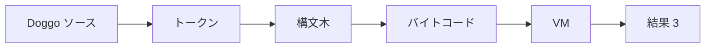
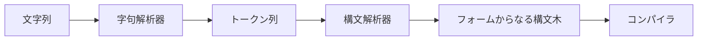
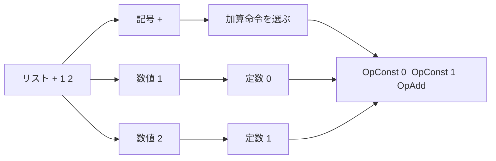
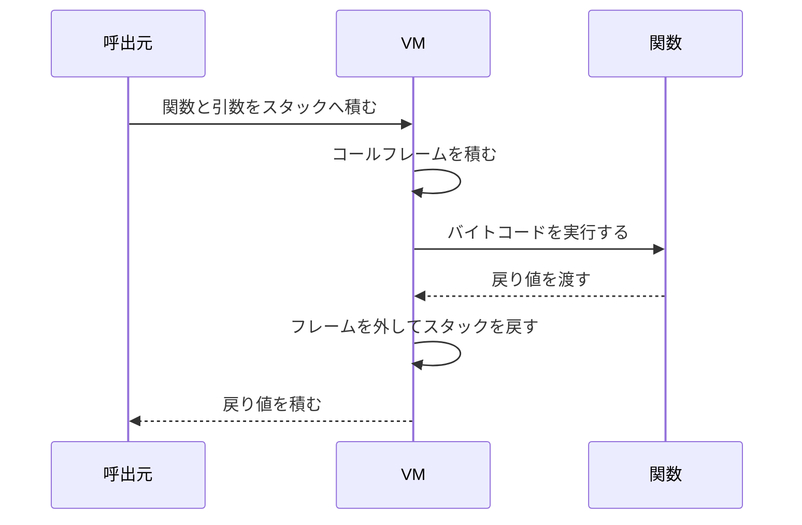
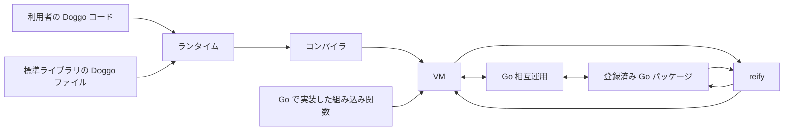

# Doggo のコードが動くまで

```doggo
(+ 1 2)
```

このコードの結果は `3` です。Doggo は、文字を読んですぐに足し算するのではありません。ソースコードをトークンと構文木に変え、コンパイラがバイトコードを作り、仮想マシンである VM がその命令を実行します。

`(+ 1 2)` は、かっこの中の先頭に処理、その後ろに引数を書く形です。この例では `+` が処理、`1` と `2` が引数です。

## ソースコードから結果まで

### 図1: ソースコードから結果までの流れ



図は左から右へ読みます。前半はコードの意味を段階的に整理する処理、後半は整理された命令を実行する処理です。コンパイラは構文木からバイトコードを作ります。バイトコードは、Doggo の VM が読める小さな命令列です。

全体は、コンパイラとスタックを使う VM を組み合わせた構成です。VM は、Doggo の命令を一つずつ進める仮想的な計算機です。実際の CPU の命令を直接並べる代わりに、`OpConst` や `OpAdd` のような Doggo 専用命令を解釈します。そのため、ソースコードの読み取りと実行を分けて考えられます。

## 文字列をトークンとフォームにする

`(+ 1 2)` は、まず次の五つのトークンに分かれます。

```text
(   +   1   2   )
```

トークンは、かっこ、記号、数値など、構文を読むための最小単位です。この例では `+` は記号、`1` と `2` は数値として分類されます。

### 図2: 字句解析からコンパイラまでの段階



図は左から右へ読みます。字句解析器が文字列をトークンに分け、構文解析器が対応するかっこをまとめて、フォームからなる構文木を返します。フォームとは、数値一つやリスト一つのように、Doggo が一つのまとまりとして読める式です。ファイルには複数のフォームを書けます。

構文木は、フォームの親子関係をノードで表したものです。`(+ 1 2)` の根はリストで、その子は記号 `+`、数値 `1`、数値 `2` です。各ノードは元のファイル名、行、列、文字位置も保持するため、コンパイルエラーを元のコードに結び付けられます。

## コンパイラがバイトコードを作る

### 図3: 構文木からバイトコードへの変換の概念図



図は左の構文木から右の命令列へ読みます。これは関係を示す概念図です。正確な命令順とスタックの変化は図9の表に示します。

コンパイラは構文木をコンパイラ用のフォームへ下げ、記号がローカル変数、グローバル変数、組み込み関数のどれを指すか解決します。その後、命令列と定数プールを作ります。定数プールは、数値や文字列などを命令とは別に置く配列です。

現在のコンパイラは、二引数の `+` を直接の加算として扱います。`1` と `2` を定数プールへ置き、各値を積む `OpConst` と、二つの値を加える `OpAdd` を出します。一般の関数呼び出しでは、呼び出す値と引数を積んでから `OpCall` を出します。

## VM とオペランドスタック

### 図4: 加算中のオペランドスタック

<!-- stack-diagram -->
```text
開始             OpConst 0        OpConst 1        OpAdd

  空               上               上               上
                 ┌───┐           ┌───┐           ┌───┐
                 │ 1 │           │ 2 │           │ 3 │
                 └───┘           ├───┤           └───┘
                                 │ 1 │
                                 └───┘
                                  下
```

図は左から右へ読み、各箱は下から上へ値が積まれます。`OpConst 0` が `1` を積み、`OpConst 1` が `2` を積みます。`OpAdd` は上の `2` を右辺、その下の `1` を左辺として取り出し、結果の `3` を積みます。

この一時的な値の置き場所がオペランドスタックです。VM は命令位置を進めながら、命令が必要とする値をスタックから取り出し、結果を戻します。トップレベルの命令列では最後に専用の戻り命令を足さず、実行終了時のスタック最上部が結果になります。

## 関数呼び出しとコールフレーム

### 図5: Doggo 関数を呼んで戻る流れ



図は上から下へ読みます。呼び出し時には、スタック上に呼び出す関数と引数が並びます。VM は関数の命令位置、ローカル変数の開始位置、クロージャ、例外処理の位置をまとめたコールフレームを作ります。

クロージャは、関数本体と、その関数が外側から取り込んだ値を組み合わせたものです。

引数はフレームが指すローカル変数領域の先頭に置かれ、残りのローカル変数用の場所も確保されます。関数が戻ると、VM はそのフレームの関数、引数、ローカル変数、一時値をスタックから外し、同じ場所へ戻り値を一つ積みます。これにより、関数が別の関数を呼んでも、それぞれの命令位置とローカル変数が混ざりません。

Go で実装された組み込み関数は Doggo のバイトコードを持たないため、同じ Doggo 用コールフレームは作りません。VM が引数を渡して Go 関数を呼び、返された値でスタック上の関数と引数を置き換えます。

## ランタイム、標準ライブラリ、組み込み関数、Go インターフェース実装

### 図6: 実行時の部品と接続



図は左から中央へ進む通常の実行経路と、右側の Go との往復に分けて読みます。ランタイムは VM だけではなく、コンパイラ、名前空間、定数、グローバル変数、ライブラリの読み込みをまとめる実行環境です。

標準ライブラリは主に `stdlib/doggo/*.dog` にある Doggo のソースコードです。利用者のコードと同じように読み取り、コンパイルして実行されます。`require` はプロジェクト内の標準ライブラリを先に探し、なければ実行ファイルに埋め込まれた標準ライブラリを読みます。起動時に中核の名前空間を読み込む構成も、この仕組みを使います。

組み込み関数は Go で実装され、ランタイムの一覧に登録された基本処理です。コンパイラは一覧上の位置をバイトコードへ記録し、VM は `OpGetBuiltin` でその関数を取得します。標準ライブラリは組み込み関数を材料にして、より高い水準の機能を Doggo で定義できます。

Go 相互運用は、登録済みパッケージの関数、型、メソッドを探し、Doggo の値と Go の値を変換して呼び出します。`reify` は Doggo の関数を持つマップから Go インターフェースの実装を作り、Go 側からメソッドが呼ばれたときに VM へ戻して Doggo の関数を実行します。

## 一つのプログラムを最後まで追う

```doggo
(+ 1 2)
```

この一行を、ソースから結果まで順に追います。

1. ソース: 文字列 `(+ 1 2)` を字句解析器へ渡します。
2. トークン: `(`、`+`、`1`、`2`、`)` に分かれます。
3. フォームと構文木: 一つのリストフォームになり、子は記号 `+`、数値 `1`、数値 `2` です。
4. バイトコード: 定数プールは `[1, 2]`、命令は `OpConst 0`、`OpConst 1`、`OpAdd` です。
5. スタック: `[]` から `[1]`、`[1, 2]`、`[3]` と変わります。
6. 結果: VM のスタック最上部に残った `3` が返ります。

### 図7: 検証済みバイトコードとスタックの変化

| バイトコード命令 | 実行前のスタック | 実行後のスタック | 結果 |
|---|---|---|---|
| `OpConst 0` | `[]` | `[1]` | 定数プールの `1` を積む |
| `OpConst 1` | `[1]` | `[1, 2]` | 定数プールの `2` を積む |
| `OpAdd` | `[1, 2]` | `[3]` | 右辺 `2` と左辺 `1` を加える |

表は上から一行ずつ読みます。スタック表記は左が下、右が上です。この命令列は `internal/compiler/compiler_arithmetic_test.go` のコンパイラテストと、VM の `OpConst` および二項演算の実装に一致します。トップレベルなので、この三命令の後ろに `OpReturnValue` はありません。

## ソースコードを読む順番

最短の読み順は次のとおりです。

1. `internal/syntax/frontend/reader.go` で、ソースが字句解析器と構文解析器へ渡る入口を確認します。
2. `internal/lexer/lexer.go`、`internal/parser/parser.go`、`internal/syntax/form/form.go` で、トークンと構文木を確認します。
3. `internal/compiler/session.go`、`internal/compiler/compile_form.go`、`internal/compiler/compiler_ops.go` で、フォームの解決と命令生成を追います。命令の定義は `internal/opcode/opcode.go` にあります。
4. `internal/vm/vm.go`、`internal/vm/stack.go`、`internal/vm/frame.go`、`internal/vm/execution_machine.go` で、命令、スタック、コールフレームを追います。
5. `internal/runtime/composition/standard.go`、`internal/vm/runner.go`、`internal/vm/loader.go`、`internal/vm/builtin_catalog_default.go` で、ランタイム、標準ライブラリ、組み込み関数の接続を確認します。
6. `internal/interop` と `internal/reify` で、Go の値変換、登録済みパッケージ、Go インターフェース実装を確認します。
